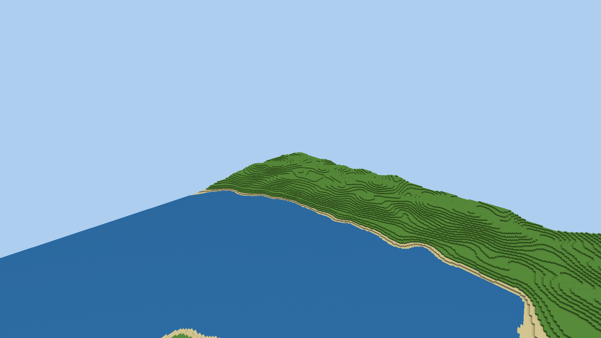
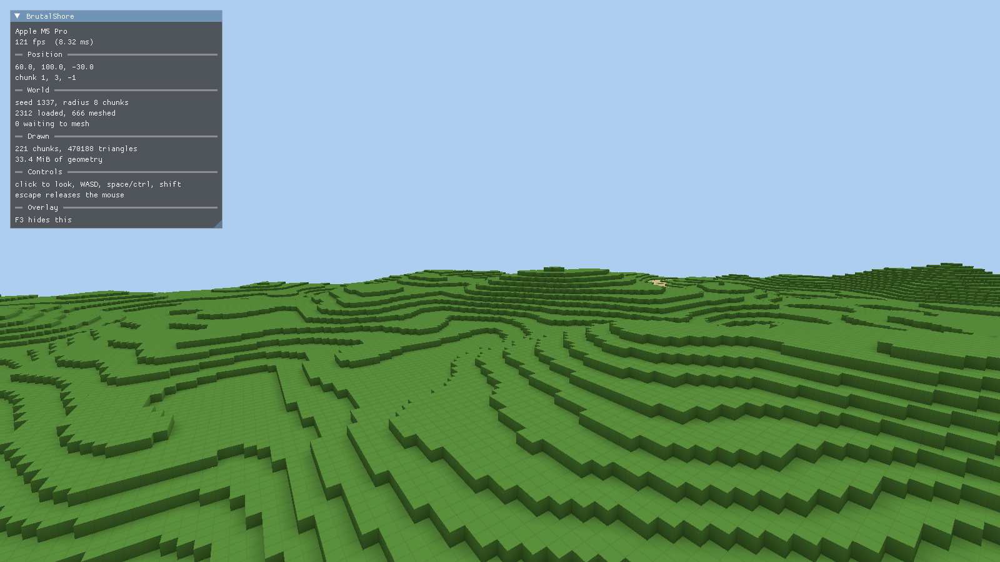

# BrutalShore

An engine, and a voxel game on it, in C# on
[BRUTAL](https://github.com/ahwootech/BRUTAL) — the open-source framework behind
Kitten Space Agency.



An unbounded world of 32³ chunks, generated from a seed rather than stored,
streamed around the player on worker threads, greedy-meshed with ambient
occlusion, and drawn through a Vulkan renderer written here: a sky with a sun
and a moon crossing it, shadows cast from whichever is up, light that floods a
cave through a hole in its roof and stops fifteen blocks in, water you can see
through and swim in, and biomes from desert to tundra whose forests span chunk
boundaries without anything being saved.



## Running it

Needs the [.NET 10 SDK](https://dotnet.microsoft.com/download). On macOS it also
needs a Vulkan driver and loader, which BRUTAL does not ship:

```bash
brew install molten-vk vulkan-loader
```

Nothing else: the loader is found and registered from inside the process, so no
environment variables have to be set. If either is missing, the game says so and
names the command above.

```bash
dotnet run --project games/Shorebound -c Release
```

Click `Play`, then `WASD` to move, `space` to jump, `shift` to sprint and `ctrl`
to crouch — crouching is slower, lower, and will not walk off an edge. A ledge
one block high is walked up rather than jumped. `F` switches between walking and
flying, where `space` and `ctrl` go up and down; `space` swims up in water.

Whichever block is in reach of the crosshair is outlined. **Hold** left click to
break it — each block takes its own time and cracks while it goes, and looking
away gives up whatever was done. What comes out falls on the ground, and walking
near it puts it in your row. Right click places one back, which spends it, and
the number keys, `Q` and `E`, or the mouse wheel pick which.

The row starts empty, because a row that never ran out made placing a block free
and breaking one pointless. `I` or `tab` opens the rest of what you carry —
three more rows of it, and a three-by-three grid to make things on. Left click
moves a whole stack and right click moves half or one; the list beside the grid
says what can be made now, and clicking a line lays it out for you.

### Digging down

Rock is not all rock. Coal, copper, iron and ember sit in it in seams, each in
its own band of depth, so what you find is decided by how far down you went
rather than how long you dug. A seam is a connected body: find one block of it
and the next one is next to it. Ember is the deepest and rarest, and it glows,
which is the only reason anyone would be able to see one coming.

Ore is dead weight on its own. **Smelters** turn it into metal: feed one ore and
something that burns, and it works whether you are watching or not. Coal burns
longest, wood will do until you find some. A smelter left running is still
running when you open the world again.

### Hands off

A smelter you feed by hand is a slower way of crafting. Two more machines change
that:

A **conveyor** carries what is put on it to the block in front, in whichever
direction you were facing when you laid it. It takes the output of the machine
behind it and gives it to whatever is ahead — another belt, or a smelter, which
sorts the ore from the fuel itself, so one line can feed both.

A **miner** stands on a seam and keeps bringing it up for as long as it has
something to burn. It never consumes the seam: the cost of a vein is the walk
out to it and the fuel, not how much is left in it.

A **lift** is a belt that goes up, because everything worth having is below
everything you want to build on.

A drill, a few belts, a lift and a fire is a line that runs while you are a
hundred metres down a shaft. That is the whole point, and it is also the
problem — see below.

### Current

A fire under every machine is a fire you have to walk to. A **generator** burns
fuel in one place and **cable** carries the result to everything it touches: a
wired smelter or drill needs no fuel of its own, and one that is not wired falls
back to burning, so a half-wired works still runs.

Cable touching cable is one grid; a machine between two runs does not join them.
That matters, because a grid that is asked for more than it has slows everything
on it down *together* rather than stopping some of it — so a player who put
their turrets on the smelters' generator finds out, the first time a fight
starts mid-smelt, that they built one grid where they needed two.

A generator burns only what was actually drawn from it. One left running into a
grid with nothing switched on costs nothing.

### What the shore asks

`M` opens the milestones. Each one takes a quantity of what you have just
learned to make and opens up the next thing — the smelter is bought with stone
and planks, the lantern with ember out of a deep shaft. Nothing else unlocks
recipes, and a pattern you were not meant to know yet makes nothing even if you
guess it.

They are a tree rather than a queue. After the first smelt the shore opens two
ways at once — light, to go deeper, and belts, to stop carrying — and more than
one of them is payable for most of the game, so the order is yours. The two come
back together at the drill, which needs what both arms gave: branching without
rejoining would mean writing two games, and a branch nobody takes is content
nobody sees. A locked step says which steps it is waiting on, so the tree can be
read backwards from whatever you want next.

### The dark

Animals graze the open ground. They wander, step up the same one-block ledges
you do, and will not let you get close.

The other things do not graze. **Stalkers** come out of anywhere a lamp and the
sky both fail to reach — which is any cave at any hour, and the whole surface at
night — and they come straight for you. Daylight finishes the ones caught out in
it. Two things decide how many: how dark it is, and how much machinery you have
running, because a bigger works is a louder one. Light what you build.

Left click swings at whatever is in front of you; two connected swings finish
one. A bar appears over the row when something lands. If you go down, what you
were carrying stays where you fell.

A **turret** does the same thing while you are asleep, and runs on electricity
and nothing else. That is where the grid earns its place: the answer to a bigger
horde becomes a bigger factory rather than a longer night awake.

`Escape` opens the menu, which has the settings and saves the world; `F3` shows
what the engine is doing.

A world is its seed plus the blocks you have changed, so a save holds nothing
else: an untouched world is about a hundred bytes however far you have walked.

### Sound

There are no audio files in this repository. Every sound is built out of
arithmetic when the world opens: a burst of filtered noise under a falling tone
is a block coming apart, and how dull the filter is comes from the same pattern
the renderer draws that block's surface with — so stone, sand, wood and snow all
sound like what they look like, and a block added tomorrow is audible without
anyone recording anything.

A machine with no working sound device plays nothing and says nothing about it.

Everything the settings screen offers applies as the slider moves — view
distance, field of view, sensitivity, brightness, volume, shadows, fog,
interface scale, the length of a day — and is written to `shorebound.settings`, one name and one
value a line, for the times it is easier to fix a setting in an editor than from
inside the game. Anything the command line mentions beats what is in that file.

### Options

| Flag                               | What it does                                     |
| ---------------------------------- | ------------------------------------------------ |
| `--seed <n>`                       | The world seed. The same seed is the same world. |
| `--view-radius <chunks>`           | How far chunks stay loaded. Overrides the setting. |
| `--time <hour>`                    | The hour the world starts at. Default 8.         |
| `--day-length <seconds>`           | Real seconds per in-game day, 0 stopping the sun. Overrides the setting. |
| `--save <path>`                    | Where the world is kept. Default `shorebound.world`. |
| `--settings <path>`                | Where the player's settings are kept. Default `shorebound.settings`. |
| `--no-overlay`                     | Start with the debug overlay hidden.             |
| `--validation`                     | Turn on the Vulkan validation layers.            |
| `--frames <n>`                     | Close after this many frames.                    |
| `--camera <x> <y> <z> <yaw> <pitch>` | Start the camera here, angles in degrees.      |
| `--screenshot <path>`              | Save the last frame as a PNG.                    |
| `--playtest`                       | Play the game from a script instead of a keyboard. |
| `--profile <path>`                 | Write a table of what the run cost.              |
| `--scenario works\|night`           | Build a running works before the run starts.     |

Passing `--frames` or `--camera` goes straight into the world rather than
stopping at the title screen: a run with a fixed frame count is a render check,
and there is nobody there to click past a menu.

The last three together are how graphics changes are checked: a fixed seed and a
fixed camera for a fixed number of frames produce an image that can be compared
against the one before. Add `--day-length 0` to stop the sun as well, or two
runs an hour apart are not comparable.

```bash
dotnet run --project games/Shorebound -c Release -- \
    --frames 400 --camera -140 190 -140 45 -22 --screenshot coastline.png
```

### Watching the middle of the game

The first morning is the part a screenshot can reach. The part worth looking at
is the hour after it: a drill on a seam, a belt into a fire, one generator
holding both up, and the dark arriving because of the noise. `--scenario` builds
that and stands back.

```bash
dotnet run --project games/Shorebound -c Release -- \
    --scenario night --frames 700 --day-length 0 --screenshot night.png
```

```
night: 9 ingots made, 13 ore waiting at the fire, 0 riding the belts,
0 stacked at the drill, 300 watts delivered of 300 asked for.
The turret fired 67 times; 4 still about.
```

Three hundred watts is the drill, the fire and the turret on one wire — the
turret only draws when something is in front of it, so that number is the dark
arriving. It is built with the same calls a player's click makes, and nothing
about it is a diorama: the recipes are unlocked, the blocks are real blocks, and
anything it builds can be broken.

It has already earned its place twice. The watcher standing beside the works at
head height was eaten, which is correct. The watcher moved ten blocks away was
not — and the turret stopped firing, because the horde hunts the player rather
than the machines and had walked straight past the works to get to them. Then
the watcher hovering fourteen blocks overhead was eaten anyway, which was a bug:
reach was being measured flat, so something standing on the ground could bite a
player with nothing underneath them.

### Checking it without a GPU

The same run works on a machine with no graphics card at all, which is what
makes it usable from CI or a remote shell. Mesa's `lavapipe` is a Vulkan
implementation on the CPU, and GLFW only needs some X server to open a window
on:

```bash
sudo apt install mesa-vulkan-drivers vulkan-validationlayers xvfb
Xvfb :99 -screen 0 1600x900x24 &
export DISPLAY=:99 VK_ICD_FILENAMES=/usr/share/vulkan/icd.d/lvp_icd.json

dotnet run --project games/Shorebound -c Release -- \
    --frames 400 --camera -140 190 -140 45 -22 --day-length 0 \
    --validation --screenshot coastline.png
```

It renders at a few frames a second, which a fixed frame count makes irrelevant.
Add `--validation` whenever GPU code changes: the validation layers catch the
class of mistake that works anyway on one driver and corrupts memory on the
next, and they found a real one here — a swapchain image being copied from
without having asked for the usage that allows it.

### Playing it with nobody there

A screenshot proves that a frame came out right. It says nothing about whether
breaking a block puts it in the row, or whether the inventory opens. `--playtest`
covers that: it drives the real game through a script — click play, land, look
down, break six blocks, open every screen, walk, pause, resume — and prints
where it has got to as it goes.

```bash
dotnet run --project games/Shorebound -c Release -- \
    --playtest --frames 900 --screenshot playtest.png
```

```
[   6.1s] clicking play
[  24.1s] breaking block 1
[  54.2s] opening what I am carrying
[  85.1s] done
```

The script is a `SessionScript`, which is engine-side and holds no file format:
a step is a method call, so a control that is renamed breaks the build instead
of silently doing nothing. `ScriptedInput` merges with the real window rather
than replacing it, so a person watching can still take over mid-run.

It has already earned it: the key that opens the inventory did not close it
again, because closing a panel puts the player back to playing inside the same
frame and the second place that read the key opened it straight back up. Only
escape ever closed anything, and nothing short of playing the game through
would have said so.

Add `--profile <path>` and the run leaves its costs behind as well as its
picture:

```
                    share     mean      p50      p99    worst
frame              100.0%  299.250  316.228  384.254  384.254
  simulation         0.0%    0.097    0.004    1.413   24.357
  presenting        97.5%  291.729  316.228  354.813  375.694
  chunks             0.1%    0.242    0.079    6.310   21.074
```

Those are the whole run rather than the overlay's last four seconds, which is
the difference between a number that can be compared with yesterday's and one
that can only be watched. They come out of a `Histogram` of twenty buckets to
the decade, so a percentile over a ninety-second run is one walk over a hundred
and twenty counters and costs nothing to keep.

## Layout

`src/` is the engine and `games/` is what is built with it. **Nothing in `src/`
references `games/`** — the engine is what would still make sense if Shorebound
were deleted.

| Engine project        | What is in it                                               |
| --------------------- | ----------------------------------------------------------- |
| `BrutalShore.Core`    | The frame clock and the f64 world to f32 render-space boundary |
| `BrutalShore.Voxel`   | Chunks, the block registry, the greedy mesher                 |
| `BrutalShore.Gpu`     | Window, Vulkan device, swapchain, frames in flight, shaders, and `IInputSource` so a script can play in a person's place |
| `BrutalShore.Ui`      | What every panel looks like: the palette, the ImGui theme, the shared widgets |
| `BrutalShore.Audio`   | Waveforms, a synthesiser that makes them out of arithmetic, and the device they play through |
| `BrutalShore.World`   | Coordinates, gradient noise, streaming, block edits, ray casting and collision, `IChunkGenerator` |
| `BrutalShore.Render`  | Camera, view frustum, the sun and sky, shadows, the ray marching field, the voxel pipeline, chunk meshes, loose cubes |
| `BrutalShore.Runtime` | The window, the device and the frame loop around an `IGame`   |

| Game            | What is in it                                        |
| --------------- | ---------------------------------------------------- |
| `Shorebound`    | Its blocks, its terrain, caves and biomes, its trees, the player and how they move, breaking and dropping, the controls, what they carry and craft, ore seams, machines, belts, lifts, power and turrets, milestones, its own sounds, the animals and the horde, the title and settings screens, the save and settings files, how long a day lasts, how much work a frame may spend loading and meshing |

A game is an `IGame` the runtime runs, and an `IChunkGenerator` the world asks
for blocks. Those two interfaces are the whole of the engine's knowledge of it.

Dependencies point downwards only. Everything that does not need a device is
tested without one: `dotnet test` runs the mesher, the noise, the streaming, the
block edits, the ray cast and the collision, the light fill, the camera, the
frustum, the sun's arc, the shadow box, and Shorebound's own terrain, biomes,
trees, player, breaking, dropping, carrying, settings and save file.

## How the world is lit

Four kinds of light, and only one of them costs anything per frame.

**Sky light** is a flood fill, worked out on a worker thread when a chunk is
meshed, over the chunk and sixteen blocks around it — which is the smallest box
that gives the right answer, since light travels fifteen blocks and a source any
further out arrives at nothing. Every cell with nothing above it starts at
fifteen and loses a level per block it travels, so a cave mouth is bright, the
twentieth metre of a tunnel is black, and a shaft open to the sky carries
daylight to the floor however deep it is. Water costs two levels a block, which
is what turns depth into darkness.

**Block light** is the same fill from a different seed: anything that glows,
which so far is the lantern.

Both are sampled per face corner, averaged over the four cells touching it, and
baked into the eight bytes of each vertex — so the frame reads two nibbles it
already had room for, and nothing about lighting a world of caves reaches the
renderer. Putting light into the merge key costs 1.2% more triangles, measured:
outdoor terrain is almost uniformly skylit, so the splits happen only under
canopies and at cave mouths.

**The sun and the moon** are a shadow map, which is the one thing the two fills
cannot do: a mountain's shadow falling across a valley at low sun is directional,
and sky light is not.

**The light in your hand** is the only one that moves, and the only one computed
per frame. It needs no shadows and is given none — a light at the eye reaches
everything the eye can see, because anything blocking it would be blocking the
view. Putting the lantern down hands it back to the flood fill, where it gets
real occlusion for free.

## Rays through a grid

Water reflects what is around it, and the reflection is traced rather than
faked. There is no hardware ray tracing involved and there could not be: the one
Vulkan implementation this has to run on besides a desktop driver is MoltenVK,
which does not expose the ray tracing extensions at all. It would also be the
slower answer. Hardware ray tracing exists to walk a tree over arbitrary
geometry, and this world is not arbitrary geometry — it is a regular grid, where
finding the next surface along a ray is arithmetic.

So the ninety-six blocks around the camera are kept in a 3D texture, one texel a
block, holding the block's colour and whether it is solid, see-through or
nothing. A worker fills it from a frozen set of chunk references whenever the
camera drifts an eighth of the way across it or the world inside it changes, and
the fragment shader walks it with the same traversal the game uses on the CPU to
work out which block the crosshair is on.

What falls out of that is water that behaves: almost transparent looking
straight down into it, almost a mirror looking across it, with the far bank in
it. Beyond the cube a ray finds nothing and the sky is used instead, which is
also what the water further away than forty-eight metres shows. It is the one
setting worth real frame time, so it is a setting.

## How the world is drawn

A chunk is 32³ block ids. Meshing it is three reductions, in order: a face is
only built if what is in front of it does not hide it — air hides nothing, an
opaque block hides everything, and water hides only more water, which is what
makes a sea a surface rather than a lattice; faces on a chunk boundary are
culled against the neighbouring chunk, which is why a chunk is only meshed once
its whole 3×3×3 neighbourhood is loaded; and the faces that survive are merged
greedily into the largest rectangles that share a colour, an opacity **and** an
ambient occlusion pattern. A solid chunk goes from 196,608 triangles to 12.

Each corner carries its position, face direction, ambient occlusion, light,
colour, opacity, surface pattern and texture layer. Surface coordinates still
come from the position, so greedy-merged faces tile once per block rather than
stretching one texel over the whole rectangle.

Terrain and built blocks use selected 64× textures from the Faithful Resource
Pack; untextured surfaces retain their procedural shader patterns. Only mapped
textures are copied to the game output. Faithful's unmodified license is shipped
with the game and its textures are credited in the title screen. Builds containing
them must not be monetized; see `games/Shorebound/Assets/Faithful/LICENSE.txt`.
The pack itself is local and git-ignored: place it at
`games/Shorebound/Assets/Faithful/`. Without it, Shorebound uses its procedural
block surfaces and remains playable.

A frame is three passes. The sun's shadow map first, off-screen, with the solid
half of every chunk the light can see — snapped to a texel grid so the shadows
do not crawl as the camera moves. Then the sky, a single triangle with the sun,
the moon and the stars on it. Then the world: the solid half of each chunk with
the depth buffer sorting it, and the see-through half blended over the top, far
to near.

Everything is drawn camera-relative. The camera's position is the origin of
render space, and each chunk's offset from it is subtracted in f64 before being
narrowed to f32, so there is no distance at which vertices start to shimmer.

## Where the work happens

Generating a chunk and meshing it are both pure functions of a coordinate and a
seed, so both run on worker threads and neither is on the frame. What is left on
the frame is the handover — applying the player's edits to a chunk that has just
arrived, and copying a finished mesh into a GPU buffer — which the overlay's
breakdown puts at a couple of milliseconds against a view of half a million
triangles.

The height is three questions rather than one field, because one field only
answers one. *Where is there land* is a very slow field deciding sea floor,
shelf, coast and interior. *How worn down is it* is slower still and decides how
much relief a region gets — not its shape. *What shape* is a ridged field, which
is folded about zero and squared so that its high ground is a network of creases
rather than a crumpled sheet; summed hills have no skyline, which is why terrain
made of them alone always looks like terrain made of them alone. Multiplying the
second into the third is what puts flat country next to mountains instead of one
uniform roughness everywhere.

All three are sampled through a domain warp: the point itself is moved by a
coarser field before anything is read from it. Gradient noise is built on a
square lattice and its contours close into rings around every extremum, so the
unwarped version of this drew a world of concentric terraces behind a ruler
straight beach. Bending the plane costs two samples and is the largest single
difference between terrain that looks generated and terrain that does not.

The last turn of it was a measurement rather than a judgement. With ridges three
hundred blocks across and seventy blocks of relief, a mountainside climbs seven
tenths of a block per block — and rounding that to whole blocks draws a contour
map, not a mountain. Probing the generator said the steepest step anywhere in
eight kilometres was two blocks, so there were no cliffs in the world at all.
Tightening the ridges and stretching the middle half of the field across its
whole range doubled the slope where a mountainside is and flattened what was
left into valley floor and summit. Whatever climbs three blocks between one
column and the next is drawn as bare rock, which is also the only thing that
tells a player at a distance where the stone they want is already exposed.

Trees are the reason the generator's contract is worth reading. A trunk at one
coordinate puts leaves in chunks the trunk is not in, and no chunk may ask
another what it contains. So every chunk works out from the seed alone which
trees could reach it, builds each of them in full, and keeps the part that falls
inside itself. Both sides of a boundary agree because both did the same
arithmetic.

Biomes work the same way, out of two noise fields a kilometre or so across — how
warm a place is and how wet — which pick what the ground is made of and how much
of the forest grows there. The density is weighted rather than switched, against
the same hash that decides whether a cell holds a tree at all, so a forest thins
out into a plain over a few hundred metres instead of stopping at a line no
terrain feature explains.

## BRUTAL

BRUTAL is consumed from NuGet and pinned in `Directory.Packages.props`. It is
not forked and not vendored: the framework is weeks old and improving quickly,
and an upstream release should cost one line here rather than a merge. A clone
of the upstream repository sits beside this one as reference source, since there
is no documentation site — reading the framework is how its API is learned.

Its licence is MIT-shaped with an attribution requirement on anything shipped to
end users: the copyright notice in the credits, the BRUTAL logo before gameplay,
and `NOTICE.txt` alongside the build. `NOTICE.txt` is here; the credits screen
and the logo have to exist before any build is distributed.
